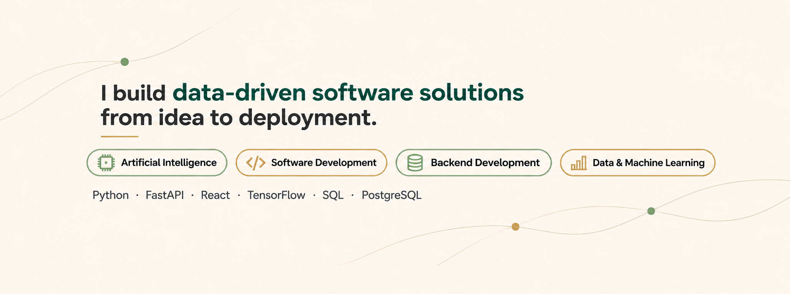

# Hi, I'm Hanan Alharbi 👋

### Computer Science | Applied AI & Machine Learning | Software Development

Final-year Computer Science student at **Taibah University**, expected to graduate in **January 2027**.

I build data-driven software solutions that turn ideas into practical applications. My interests span Artificial Intelligence, Machine Learning, backend development, and web and mobile application development.

I enjoy solving real-world problems through technology, exploring new tools, and building projects that combine software engineering with applied AI.

---

## 👩‍💻 About Me

- 🎓 Bachelor's student in Computer Science at Taibah University.
- 🤖 Interested in Applied AI, Machine Learning, and intelligent systems.
- 💻 Experienced in Python development, backend APIs, and software engineering.
- 📱 Worked on web and mobile application development.
- 🧠 Interested in data-driven solutions, computer vision, and sports analytics.
- 🚀 Enjoy collaborating on technical projects and turning ideas into working prototypes.
- 🌍 Open to opportunities in AI, Machine Learning, and Software Development.

---

## 🛠️ Technical Skills

**Programming Languages**
- Python, Java, C/C++, JavaScript, TypeScript, Dart, SQL

**AI, Machine Learning & Computer Vision**
- Scikit-learn, TensorFlow, Keras
- Logistic Regression, Transfer Learning
- FaceNet, Siamese Networks
- OpenCV, MTCNN
- Google Gemini, Google Gen AI SDK

**Backend Development**
- FastAPI, Node.js, Express.js
- REST API Development
- Pydantic, SQLModel, SQLAlchemy
- JWT Authentication

**Web & Mobile Development**
- React, Flutter, Streamlit, JavaFX
- HTML, CSS, Vite, Tailwind CSS

**Databases & Data Processing**
- PostgreSQL, Supabase, SQLite
- Pandas, NumPy, SciPy
- Drizzle ORM

**Parallel Computing**
- MPI
- OpenMP

**Tools & Technologies**
- Git, GitHub
- Visual Studio Code
- Visual Studio
- NetBeans
- Pytest

---

## 🚀 Featured Projects

### 1. AIRA – Athlete Insight, Readiness & Analytics

An AI-powered athlete readiness and injury-risk decision-support system designed to help coaches monitor training workloads, evaluate recovery indicators, and identify potential risk patterns.

The system combines a rule-based readiness engine with a temporal Machine Learning model to generate readiness scores, risk assessments, early warnings, and explainable recommendations.

**My Role:** Team Lead | Team of 3

**Key Contributions:**
- Led the project team and coordinated development activities.
- Worked on the hybrid AI decision-support concept.
- Combined rule-based readiness assessment with temporal ML risk estimation.
- Developed What-If scenario simulation and event readiness capabilities.

**Technologies:** Python, FastAPI, Streamlit, Scikit-learn, Logistic Regression, Pandas, NumPy, SciPy, Joblib, Plotly, SQLite.

[GitHub Repository](https://github.com/hanan-alharbi-cs/AIRA) | [Live Demo](https://tp9cdmkudbq9svafbkkzoq.streamlit.app/) | [Project Demo Video](https://youtu.be/0rxrEvFUUQc)

---

### 2. Rashed – AI-Assisted Water Conservation

A bilingual AI-assisted water conservation platform designed to help Saudi households understand water consumption, analyze water bills, identify unusual consumption patterns, and explore practical water-saving strategies.

The platform integrates Google Gemini for bill information extraction, AI-assisted interpretation, and personalized conservation recommendations, while deterministic backend calculations handle numerical analysis.

**My Role:** Team Lead | AI Component & Research | Team of 5

**Key Contributions:**
- Led and coordinated the project team.
- Took responsibility for the AI-focused component and explored Google Gemini use cases.
- Researched household water consumption and conservation.
- Identified AI opportunities for bill extraction, consumption insights, and intelligent recommendations.

**Technologies:** React, TypeScript, Vite, Tailwind CSS, Node.js, Express.js, PostgreSQL, Drizzle ORM, Google Gen AI SDK, Gemini 2.5 Flash.

[GitHub Repository](https://github.com/hanan-alharbi-cs/Rashed) | [Live Demo](https://rashed-water.replit.app)

---

### 3. IAttend – Intelligent Attendance Management System

A mobile-based smart attendance management system designed for higher education, combining facial verification and location-based validation to support attendance check-in and check-out.

The system supports faculty session management, student attendance, attendance history, and reporting.

**Project Type:** Capstone / Graduation Project

**Technologies:** Flutter, Dart, Python, FastAPI, Supabase, PostgreSQL, TensorFlow, Keras, FaceNet, Siamese Networks, OpenCV, MTCNN, Geolocator.

**Key Contributions:**
- Database implementation and backend integration.
- User registration and login functionality.
- Session creation and management.
- Facial verification and location verification.
- Attendance history and course session features.
- Faculty session functionality.

[GitHub Repository](https://github.com/hanan-alharbi-cs/IAttend-System) | [Project Walkthrough](https://youtu.be/--7hJHmCb1k)

---

### 4. Parallel Computing – Performance Analysis

A parallel computing project that implements Square Pyramidal Number calculations using serial, MPI, and OpenMP approaches.

The project explores workload distribution and compares execution time across different parallel programming models.

**My Role:** OpenMP Developer

**Technologies:** C/C++, MPI, OpenMP.

**Key Contributions:**
- Developed the OpenMP implementation.
- Applied parallel loop execution and reduction.
- Used static scheduling for iteration distribution.
- Worked with configurable thread counts and execution-time measurement.

[GitHub Repository](https://github.com/hanan-alharbi-cs/Parallel-Computing-Project)

---

### 5. 3D Kaaba Scene – JavaFX

An interactive 3D visualization of the Kaaba and its surrounding environment, developed using JavaFX.

The scene includes textured 3D objects, nighttime lighting, an animated moon, interactive camera controls, and a toggleable rain particle system.

**Technologies:** Java, JavaFX, 3D Graphics, PhongMaterial, PerspectiveCamera, JavaFX Animation.

[GitHub Repository](https://github.com/hanan-alharbi-cs/kaaba-3d-scene)

---

### 6. Online Gift Shop – Web Development

A front-end e-commerce project that demonstrates basic online shopping functionality.

The project includes product information, shopping cart operations, dynamic total price calculation, and browser-based cart persistence using LocalStorage.

**Technologies:** HTML, CSS, JavaScript, LocalStorage.

[GitHub Repository](https://github.com/hanan-alharbi-cs/online-gift-shop)

---

## 🎓 Education

**Bachelor's Degree in Computer Science**  
Taibah University  
Expected Graduation: January 2027

**Associate Degree in Computer Networks**

---

## 📫 Connect With Me

- 💼 [LinkedIn](https://www.linkedin.com/in/hanan-alharbi-7a9b9037a/)
- 💻 [GitHub](https://github.com/hanan-alharbi-cs)

---

*Building practical software solutions through Artificial Intelligence, Machine Learning, and Software Development.*
